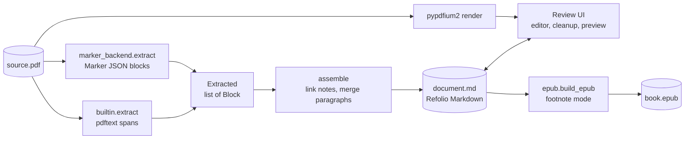

# Refolio: technical breakdown

This is the maintainer's guide: how Refolio is put together, why it's built this way, and where the bodies are buried. It describes version 0.1.0. When code and this document disagree, the code wins; please fix this document.

## Contents

1. [What Refolio is, in engineering terms](#1-what-refolio-is-in-engineering-terms)
2. [Stack](#2-stack)
3. [Repository map](#3-repository-map)
4. [Data flow](#4-data-flow)
5. [The contract: Block model and Refolio Markdown](#5-the-contract-block-model-and-refolio-markdown)
6. [The built-in converter](#6-the-built-in-converter)
7. [The Marker adapter](#7-the-marker-adapter)
8. [Assembly: footnotes, paragraphs, hyphens](#8-assembly-footnotes-paragraphs-hyphens)
9. [The EPUB writer](#9-the-epub-writer)
10. [Cleanup operations](#10-cleanup-operations)
11. [The web app](#11-the-web-app)
12. [CLI and packaging](#12-cli-and-packaging)
13. [Tests](#13-tests)
14. [Design decisions and the alternatives turned down](#14-design-decisions-and-the-alternatives-turned-down)
15. [What's new and what's borrowed](#15-whats-new-and-whats-borrowed)
16. [Known limitations and technical debt](#16-known-limitations-and-technical-debt)
17. [How to extend it](#17-how-to-extend-it)
18. [Licensing](#18-licensing)

---

## 1. What Refolio is, in engineering terms

Refolio is a three-stage pipeline with a human in the middle:

```
PDF ──convert──▶ Refolio Markdown ──human review & cleanup──▶ Refolio Markdown ──build──▶ EPUB 3
```

Four principles shaped almost every decision:

- **Optimise for the ear, not the eye.** The success criterion is "what a text-to-speech voice reads, in what order". It is not "how faithful the layout is". So:
  - running heads, page numbers and boilerplate are deleted, not styled;
  - footnotes are a first-class, user-chosen policy;
  - figures and tables are dropped.
- **The intermediate format is the product.** Conversion will never be perfect. So the converter's output is a plain-text format a person can fix in minutes or less, and the EPUB is generated from that text deterministically.
- **Small, inspectable heuristics over opaque models by default.** The built-in converter is ~450 lines of geometry and font statistics. A machine-learning converter (Marker) is optional, behind the same interface.
- **Local-first, zero-build.** One Python package, no Node toolchain, no database, no network calls at runtime. The front end is plain HTML, CSS and JS served by the same process.

## 2. Stack

| Layer                   | Choice                                                                                 | Version used               | License                                      | Why                                                                                                               |
| ----------------------- | -------------------------------------------------------------------------------------- | -------------------------- | -------------------------------------------- | ----------------------------------------------------------------------------------------------------------------- |
| Language                | Python                                                                                 | ≥ 3.10 (developed on 3.12) | —                                            | The PDF and ML ecosystem lives here                                                                               |
| PDF text extraction     | [pdftext](https://github.com/datalab-to/pdftext)                                       | 0.7.x                      | Apache-2.0                                   | Span-level text with font name, size, weight, flags, bboxes and a superscript flag. It's what Marker itself uses. |
| PDF rendering           | [pypdfium2](https://github.com/pypdfium2-team/pypdfium2) (PDFium)                      | ≥ 4.30                     | Apache-2.0 / BSD                             | Page images for the review pane, page count, metadata. Fast and permissively licensed.                            |
| ML converter (optional) | [Marker](https://github.com/datalab-to/marker)                                         | ≥ 2.0                      | Code Apache-2.0; weights modified OpenRAIL-M | Layout models, OCR, tables. Installed via the `marker` extra.                                                     |
| Markdown → HTML         | [markdown-it-py](https://github.com/executablebooks/markdown-it-py)                    | ≥ 3.0                      | MIT                                          | CommonMark-compliant, `xhtmlOut` mode, fast                                                                       |
| Web server              | FastAPI + Uvicorn                                                                      | ≥ 0.110 / ≥ 0.29           | MIT / BSD                                    | Tiny JSON API plus static files; `TestClient` for tests                                                           |
| Uploads                 | python-multipart                                                                       | ≥ 0.0.9                    | Apache-2.0                                   | Needed by FastAPI for `UploadFile`                                                                                |
| Images                  | Pillow                                                                                 | ≥ 10                       | MIT-CMU                                      | PNG encoding of rendered pages                                                                                    |
| Front end               | Vanilla JS, CSS, HTML                                                                  | —                          | —                                            | No build step, works offline, easy for contributors                                                               |
| Packaging               | hatchling; [uv](https://docs.astral.sh/uv/) for installs                               | —                          | —                                            | uv downloads its own Python, so end users need nothing preinstalled                                               |
| Validation (dev)        | [EPUBCheck](https://www.w3.org/publishing/epubcheck/) via the `epubcheck` PyPI wrapper | 5.x                        | BSD                                          | The reference validator for EPUB. Needs Java.                                                                     |
| Tests (dev)             | pytest, httpx                                                                          | —                          | —                                            | —                                                                                                                 |

What isn't used, deliberately:

- **PyMuPDF.** It's excellent, but AGPL. Using it would force the whole project to AGPL.
- **ebooklib.** Hand-writing the EPUB is ~150 lines and gives full control over footnote markup.
- **pandoc.** It's an external binary, and its EPUB footnote handling isn't TTS-aware.
- **React or any bundler.**
- **Any LLM at runtime.**

## 3. Repository map

```
refolio/
├── refolio/
│   ├── __init__.py            version
│   ├── model.py               Block + Extracted dataclasses (the converter contract)
│   ├── textutil.py            hyphenation, sentence-end tests, escaping, document vocabulary
│   ├── backends/
│   │   ├── builtin.py         heuristic converter (pdftext)          ~450 lines
│   │   └── marker_backend.py  adapter from Marker JSON → Blocks      ~180 lines
│   ├── assemble.py            Blocks → Refolio Markdown (footnote linking, merges)
│   ├── convert.py             facade: choose backend, PDF metadata, assemble
│   ├── epub.py                Refolio Markdown → EPUB 3 (four footnote modes)
│   ├── cleanup.py             one-click Markdown transformations
│   ├── server.py              FastAPI app: projects, conversion jobs, page images, export
│   ├── cli.py                 `refolio` (GUI), `refolio convert`, `refolio build`
│   └── static/                index.html, app.css, app.js, icon.svg
├── tests/
│   ├── test_pipeline.py       17 tests: converters, assembly, EPUB, cleanup, web API
│   └── fixtures/
│       ├── make_fixtures.py   regenerates the PDFs (pdflatex, pandoc, LibreOffice)
│       └── *.pdf              three layouts, original filler text
├── Refolio.command            macOS launcher (built-in converter)
├── Refolio with Marker.command  macOS launcher (+ Marker extra)
├── .github/workflows/tests.yml  CI: Ubuntu + macOS, Python 3.12, Java 21
├── pyproject.toml, README.md, ARCHITECTURE.md, LICENSE (Apache-2.0)
```

The whole thing is about 3,400 lines including tests, CSS and the fixture generator.

## 4. Data flow



In the app:

1. Uploading writes `source.pdf` to a project folder and queues a conversion job on a single worker thread.
2. The job writes `document.md`.
3. The browser polls until the job is done, then loads the Markdown into the editor.
4. Every edit is autosaved (debounced 700 ms).
5. Export sends the current Markdown to the server, which builds the EPUB in memory and streams it back.

## 5. The contract: Block model and Refolio Markdown

There are two contracts in the system. Keeping them stable is what lets the backends, the editor and the EPUB writer evolve independently.

### 5.1 `Block` (converter → assembler)

```python
@dataclass
class Block:
    kind: str     # heading | para | quote | list | caption | footnote
    text: str     # inline Markdown; footnote marks left as <sup>…</sup>
    page: int     # 1-based source page
    level: int    # heading level, 1 = document title
    bbox: tuple | None
```

A backend's whole job is to produce `Extracted(blocks, page_count, title, author, warnings)`:

- blocks in reading order;
- body blocks and footnote blocks both included, interleaved by page;
- footnote reference marks left unresolved, as `<sup>3</sup>`.

Linking marks to notes is done once, in `assemble.py`, for all backends. Adding a backend never means re-solving footnotes.

### 5.2 Refolio Markdown (assembler → human → EPUB writer)

This is CommonMark plus three conventions:

| Construct                                                            | Meaning                                                                                                                                                                                     |
| -------------------------------------------------------------------- | ------------------------------------------------------------------------------------------------------------------------------------------------------------------------------------------- |
| Front matter: `---`, then `title: "…"` and `author: "…"`, then `---` | EPUB metadata. A deliberately tiny parser handles it: `key: "value"` lines only, no YAML dependency.                                                                                        |
| `<!-- page N -->` on its own line                                    | Page anchor. Drives the review pane's page sync and the "drop pages" helper. Stripped from the EPUB.                                                                                        |
| `[^label]` / `[^label]: text`                                        | Pandoc-style footnotes. Definitions are placed at the end of the page section they came from, so the note sits next to the PDF page it's on during review. Continuation lines are indented. |
| `<sup>…</sup>` left in the text                                      | An unmatched reference mark. It's a signal to the reviewer, and the notice bar counts it.                                                                                                   |

Why Markdown and not HTML or JSON? See [§14](#14-design-decisions-and-the-alternatives-turned-down). In short, it's the only representation that is pleasant to fix by hand, and diff-friendly too.

## 6. The built-in converter

File: `refolio/backends/builtin.py`. Entry point: `extract(pdf_path, progress)`.

### 6.1 Pipeline

```
_read_pages        pdftext.dictionary_output → Run/Line/TBlock objects (style + sup flags; real sizes from char boxes
                   when the PDF's font sizes are bogus; blocks split where the print size drops)
vocab.learn        document vocabulary for hyphenation decisions (excluding line-break fragments)
body size          the font size carrying the most characters = "body"
cover page         page 1 dropped if it mentions JSTOR + terms/stable URL
margins            running heads/feet/page numbers marked "skip"
classify           footnote / heading / quote / para, per page
xy_cut             reading order per page
emit               headings, byline, paragraphs (split if merged), footnotes (split per mark, including fused lines)
heading levels     title = 1, section levels ranked by font size from 2
```

### 6.2 Reading the PDF

- `pdftext.dictionary_output(..., keep_chars=True, disable_links=True)` gives page → block → line → span → char. Character boxes are needed for the bogus-size case below. `disable_links=True` skips link extraction, which is useless for audio.
- Each span becomes a `Run(text, size, italic, bold, sup)`:
  - **Italic:** PDF font flag bit 64, or the font name contains "italic"/"oblique", or it's a TeX italic or slanted font (`cmti`, `cmsl`).
  - **Bold:** weight ≥ 600, or a bold-ish name, or TeX `cmbx`.
  - **Superscript:** pdftext's own flag, _or_ a note-mark-looking run (`\d{1,3}` or `*†‡§¶‖#`) smaller than 0.8× the block's dominant size.

The second superscript rule is evaluated per _block_ rather than per line, after the block is built. This is what catches a note number that sits alone on its own line, which pdftext's flag misses. The two-column fixture's "5I owe this…" note exposed it.

**Bogus font sizes (Word's PDF export).** Word scales text through the text matrix and leaves the font size at 1.0, so every span reports `size == 1.0`. Body text, small print and superscripts then look identical, the size-based footnote rule never fires, and pdftext glues a superscript onto the preceding word (`civilization.”1`). When a span's size is < 3 and it has chars, `_bogus_size_runs` rebuilds its runs from the character boxes instead:

- a run's `size` is the median char box height (only ratios matter downstream, so height stands in for point size);
- a digit or symbol (`MARK_CHARS`) whose box is under 0.8× the line's median char height becomes its own superscript run.

**Ligature ghost spaces and soft hyphens.** Some fonts (Brill's Garamond, for one) set "Th", "fi" and "ff" as two glyphs sharing one box, followed by a space inside that box, so pdftext's text reads "Th is" and "qualifi ed". Span text is therefore rebuilt from the character boxes (`_clean_chars`). A space is dropped when the two glyphs before it share a box, it ends inside that box and the next letter starts right where the ligature ends; a real space after "Jeff" has the next word a space-width away, which is what tells them apart. The same pass turns the `\x02` that pdfium reports for a line-end soft hyphen into `-`, so `join_hyphenated` can mend the word (before this, the bogus-size path produced "vege tarianism").

**Mixed-size blocks.** pdftext can put the last body paragraph of a page and its footnotes in one block. After the superscript pass, `_split_by_size` splits a block wherever consecutive lines' dominant (non-superscript) size differs by more than 8%; a line that is only a note mark takes the size of the line after it. This applies to every PDF, not only bogus-size ones.

### 6.3 Body size

`body` is the most common font size, weighted by character count, over non-superscript runs in the whole document. Every later threshold is relative to it, which makes the heuristics independent of point size. Word documents at 12 pt and LaTeX at 10 pt behave the same.

### 6.4 Running heads, footers and page numbers

A block is a margin candidate if it has ≤ 2 lines and sits in the top or bottom 9% of the page (`MARGIN_ZONE = 0.09`). It's removed if any of these holds:

- it's a page number: `PAGE_NUM_RE` matches Arabic or Roman numerals and "Page N of M";
- it's known boilerplate: `BOILERPLATE_RE` catches "downloaded from", "all use subject to", JSTOR terms, ©, DOIs;
- it starts with "©" and sits in the outer 15% of the page (a publisher's copyright line, which would otherwise be glued onto the last footnote);
- its normalised text appears on ≥ max(2, 40% of pages). Normalising lower-cases the text and replaces digit runs with `#`, so "118 A. N. Author" and "120 A. N. Author" count as the same line.

Running heads that sit lower than the 9% zone are caught by the repeat rule alone, which looks in the top 15% but only at lines no larger than body type, so titles and bylines survive.

The 40% threshold is chosen so that alternating even/odd heads (author on one side, title on the other) each clear it on documents of five or more pages.

### 6.5 Classification (per page)

| Kind         | Rule                                                                                                                                                                                                                                                                                                                                                                                                                                                              |
| ------------ | ----------------------------------------------------------------------------------------------------------------------------------------------------------------------------------------------------------------------------------------------------------------------------------------------------------------------------------------------------------------------------------------------------------------------------------------------------------------- |
| **footnote** | `_find_footnotes`. A block qualifies if it's small (size ≤ 0.93 × body) or starts with a superscript note mark; it starts below 15% of the page height if small, 35% if only marked; and every block below it in the same column (> 30% horizontal overlap) is also small or marked. This "bottom stack" rule handles notes split across both columns, long notes that start high on the page, and Word documents whose notes are the same size as the body text. |
| **heading**  | Size ≥ 1.15 × body, ≤ 3 lines, ≤ 30 words. Level = rank of its size among all heading sizes. Or all-bold, ≤ 2 lines, ≤ 15 words and no sentence-ending punctuation; this gets the lowest heading level.                                                                                                                                                                                                                                                           |
| **quote**    | ≥ 2 lines, size ≤ 1.02 × body, and indented > 10 pt on _both_ sides relative to the extent of body-size blocks that overlap it horizontally (its column).                                                                                                                                                                                                                                                                                                         |
| **para**     | Everything else.                                                                                                                                                                                                                                                                                                                                                                                                                                                  |

The **title** is the first level-1 heading on pages 1–2. The **byline** is a centred (within 8% of page centre), short (≤ 10 words) block immediately after the title on the same page. Whether it was classified as a heading (large type) or a paragraph, it's emitted as a paragraph and stored as `author`. Values found here override PDF metadata, which is often junk like "Microsoft Word - draft3.docx".

### 6.6 Reading order: gutter-aware recursive XY-cut

`xy_cut(items)` is the classic recursive XY-cut with one important change.

1. Try a **vertical cut**: project blocks onto the x-axis, find gaps > 6 pt, then recurse into each column, left to right.
2. Otherwise, try **horizontal cuts**: project onto the y-axis and find gaps.
   - Plain XY-cut would recurse into every row. That breaks two-column text whenever a paragraph gap in the left column happens to line up with one in the right column; the columns then interleave. The two-column fixture hit exactly this.
   - Refolio first finds the **gutters**. It takes blocks that are both narrow (< 60% of region width) and paragraph-like (≥ 2 lines), and splits them on x. Titles and headings are excluded because a centred title would bridge the gutter.
   - A row is **spanning** if any of its blocks crosses a gutter.
   - Consecutive non-spanning rows are merged into one group before recursing, so the vertical cut can then succeed inside the group.
   - The effect: horizontal cuts happen only next to things that really span the page, like titles, full-width abstracts and figures.
3. Otherwise, sort by (y, x).

The unit test `test_xy_cut_two_columns_with_spanning_title` pins this behaviour with aligned gaps.

### 6.7 Text assembly inside blocks

- **Runs → inline Markdown** (`_runs_to_md`):
  - adjacent runs with the same style are merged;
  - text is escaped (`\`, `*`, backtick);
  - italic and bold become `*…*` / `**…**`, with whitespace moved outside the markers;
  - superscript note marks become `<sup>…</sup>`.
- **Lines → text:** lines are joined with `join_hyphenated` (§8.3). Paragraph-start Markdown syntax is escaped (`escape_block_start`), so a paragraph beginning "1. " or "# " isn't turned into a list or heading.
- **Paragraph splitting** (`_split_paragraphs`): pdftext occasionally merges several paragraphs into one block. Refolio splits after a line that ends a sentence and stops more than 15 pt short of the block's right edge.
- **Footnote splitting:** one pdftext block can hold several notes. A new note starts at any line beginning with a superscript mark, or with a plain number like "3 " near the left edge. pdftext also sometimes fuses two short notes into one _line_ (`7 Apuleius, XI, 5. 8 Tuzuk…`); `_split_at_note_marks` breaks a line at a mid-line superscript mark that follows a finished sentence.

## 7. The Marker adapter

File: `refolio/backends/marker_backend.py`.

- **API used:**
  - `PdfConverter(config=…, artifact_dict=create_model_dict(), renderer=JSONRenderer)`, with the config built via `ConfigParser({"output_format": "json", "disable_image_extraction": True, ["disable_ocr": True]})`.
  - Models are created once per process and cached in the module global `_models`.
- **Mapping:**
  - `_walk` recurses through the JSON tree (Page → groups → leaf blocks) and maps Marker's block types to Refolio kinds.
  - SectionHeader becomes a heading, with its level taken from the `<hN>` tag. Footnote, ListItem and Caption map directly. Text, TextInlineMath, Table, Equation and the like become paragraphs.
  - PageHeader, PageFooter and Reference are skipped. Picture, Figure and Diagram are skipped and counted in a warning.
- **HTML → inline Markdown:** `_Inline` is an `HTMLParser` subclass. It keeps `<sup>` so the shared assembler can link notes, converts `<i>/<b>`, and handles the common "`<i>word </i>`" whitespace placement.
- **OCR safety valve:** on macOS, Marker 2.0's OCR model is served by llama.cpp's `llama-server`. If that binary isn't on `PATH` (and `SURYA_INFERENCE_URL` isn't set), the adapter switches to `disable_ocr` and adds a warning. Without this, a born-digital PDF with one garbled block could fail halfway through.
- **Status:** written against Marker 2.0.0's source (`renderers/json.py`, `schema/blocks/*`, `config/parser.py`). The mapping is unit-tested with a fake JSON tree, and has since been run against real Marker models on a Word-exported book (pages 8–14 of a 133-page PDF, OCR off). That run showed what Marker does when the PDF's font sizes are bogus (§6.2), because it reads text through pdftext too:
  - footnote blocks come through as `Footnote` with `<sup> 1</sup>` marks (note the space inside the tag);
  - two short notes can arrive fused in one block;
  - in-text marks lose their superscript and arrive as plain digits glued to the preceding punctuation (`civilization."1 One`).

  The shared assembler fixes most of these (§8.1, §8.3). The adapter and `convert.py` fix the rest, with no superscripts, font sizes or character boxes to go on:

  - **Ghost spaces and lost hyphens.** Marker reads the same text layer, so it has "Th is" and "off ers" (§6.2), and it drops line-end hyphens, leaving "ex  tends" (two spaces, which is how it joins every line). `html_to_inline(keep_breaks=True)` keeps that double space as `LINE_BREAK`. `convert()` first reads the PDF with the built-in engine and assembles it (about a second) to get a **lexicon** of correctly spelled words, including hyphenated compounds, and `mend_split_words` then rejoins neighbouring words when the joined form is in the lexicon and the pair looks split: a half isn't a word, the first ends in a ligature, or it was a line break between two uncommon words. It also restores hyphens Marker swallowed ("equalconsideration" to "equal-consideration"). The lexicon is empty for scanned PDFs, which have no ghost spaces. The built-in pass runs under the PDFium lock.
  - **Entities cut by `</sup>`.** The HTML can contain `<sup> 30 &amp;#</sup>x27;`; the tag is moved past the entity. A `<sup>` around anything that isn't a note mark is unwrapped, and spans' stray spaces before punctuation are removed.
  - **Note tails labelled as Text.** A Text block whose box matches an (empty) Footnote block's box is turned into a footnote, so a note that runs over a page break isn't spliced into the body.

## 8. Assembly: footnotes, paragraphs, hyphens

File: `refolio/assemble.py`, plus helpers in `textutil.py`.

### 8.1 Collecting notes

`_collect_notes` walks footnote blocks in order and parses a leading mark with `LEAD_MARK_RE`, which accepts any of:

- `<sup>3</sup>`
- `3`, `3.` or `3)` followed by text
- `*`, `†`, `‡`, `§` or `¶`

Before parsing, a footnote block is split where a second `<sup>N</sup>` follows a finished sentence (`FUSED_NOTE_RE`), because converters sometimes fuse adjacent short notes into one block.

A leading `*` only counts as a mark when whitespace follows it; `*Title*` at the start of a note is italics. In the built-in converter a plain "4. " line starts a new note only after a line that ended a sentence, so "chs. 3,\n4. Another" stays one note. A page's note stack is recognised by a superscript mark anywhere in small print, since pdftext often runs several notes into one block.

**A footnote block with no leading mark is a continuation of the previous note.** Because footnote blocks arrive in reading order (left column, right column, next page), this one rule handles notes that continue in the next column and notes that continue onto the next page.

### 8.2 Linking marks to notes

**Plain-digit marks first.** If a converter lost the superscript formatting, a mark reaches the assembler as plain digits (`wake”3—for`). `_promote_plain_marks` runs before linking. For each numbered note with no `<sup>N</sup>` reference in the body on its own page or the page before, it converts the first plain `N` on the note's page (or, failing that, the previous page) into `<sup>N</sup>`. The match must follow a letter, sentence punctuation or a closing quote with no space (`PLAIN_MARK`), and be followed by whitespace, a dash or the end of the block. A cursor keeps matches in document order. This stops years and "chapter 1" from being taken for marks, but it is a heuristic: it adds a warning whenever it fires, so the reviewer knows to check.

Marker's marks arrive as plain digits with spaces round them ("status. 3 Th is", "ethics, 9 feminist", "risks 34 —could"). `_plain_mark_re` accepts these, except after "p.", "ch." and the like, and the mark's own spaces are removed. Its notes arrive fused ("... claims. 3 See ..."), sometimes with the number lost (`<sup> </sup>`). `_collect_notes` therefore splits every numbered note at the next number in sequence, and gives an empty mark the number after the previous note. An explicit `<sup>N+1</sup>` splits without a sentence end before it, since a URL note has none.

`<sup>` contents are split on commas and spaces, so `<sup>3,4</sup>` gives two marks. Each mark is matched by `_find_note`:

1. An unused note with the same mark **on the same page**.
2. Otherwise the nearest **later** page. A note can land on the next page when the citing line is at the bottom.
3. Otherwise any unused note with that mark.

Matched notes get **sequential labels in citation order** (`[^1]`, `[^2]`, …), regardless of their printed numbers. This handles numbering that restarts per chapter and symbol marks (`*`, `†`) that repeat on every page.

What's left over:

- **Unmatched marks** stay as `<sup>N</sup>`, with a warning.
- **Uncited notes** get labels after the cited ones, with a warning. The EPUB writer lists them at the end of the notes.

### 8.3 Paragraph merging and hyphenation

**Merging.** Two consecutive para (or quote) blocks are merged when `continues(prev, next)` holds. That means either of:

- the first ends with a hyphen; or
- the first doesn't end a sentence (`TERMINAL = .?!:;"”’)]…`, ignoring trailing note marks and emphasis), _and_ the next starts in lower case or the first ends with a comma.

This repairs paragraphs cut by column and page breaks. A paragraph cut between two sentences can't be detected, but that's harmless when listening.

**Hyphenation.** `join_hyphenated(left, right)` joins `"philo-" + "sophy"` to "philosophy", but keeps "self-evident". The decision uses a **document vocabulary**: `vocab.learn()` collects every word in the PDF _except_ the fragments on either side of a line-break hyphen. If they weren't excluded, "philo" and "sophy" would look like real words. The rules, in order:

1. The hyphenated form appears elsewhere and the closed form doesn't → keep the hyphen.
2. The closed form appears elsewhere → drop the hyphen.
3. The prefix is in `KEEP_HYPHEN_PREFIXES` (self, non, anti, quasi, well, …) → keep it.
4. Both halves are words longer than three letters seen elsewhere → keep it.
5. Otherwise → drop it. This is the right call for TeX's justification hyphenation, which is the common case. Speech engines read the occasional wrongly closed compound ("eighteenthcentury") almost identically anyway.

### 8.4 Writing the Markdown

Front matter comes first. Then for each page: a `<!-- page N -->` marker, the body blocks, then that page's note definitions. Pages that have only notes still get a marker.

## 9. The EPUB writer

File: `refolio/epub.py`. Entry point: `build_epub(md, mode, title, author, lang) -> BuildResult(data, body_html, warnings)`.

### 9.1 Steps

1. **Parse** (`parse`):
   - front matter → `meta`;
   - footnote definitions (with indented continuations) are pulled out into `notes`;
   - page markers and other HTML comments are removed.
2. **Footnote mode transform**, done at the Markdown level before rendering:

   | Mode              | Transform                                                                         |
   | ----------------- | --------------------------------------------------------------------------------- |
   | `endnotes`        | `[^x]` → placeholder `⟦FN:x⟧`                                                     |
   | `inline`          | `[^x]` → ` (Footnote n: text)`                                                    |
   | `after_paragraph` | `[^x]` removed; a `⟦NOTE⟧ Footnote n: text` paragraph is appended after the block |
   | `omit`            | `[^x]` removed                                                                    |

   Placeholders use `⟦…⟧` (U+27E6/7). They pass through markdown-it untouched and never occur in real text.

3. **Render** with `MarkdownIt("commonmark", {"html": True, "xhtmlOut": True})`. Then:
   - named HTML entities are converted to numeric ones (XHTML has no DTD for `&nbsp;`);
   - placeholders become `<sup><a epub:type="noteref" role="doc-noteref" id="ref-n" href="notes.xhtml#note-n">n</a></sup>`, or `<p class="note">`. A note cited twice gets ids `ref-n`, `ref-n-2`, …;
   - headings get slug ids for navigation.
4. **Well-formedness guard** (`_render`):
   - the result is parsed with `xml.etree`;
   - if a user's edit left broken HTML (an unclosed `<b>`, a stray `<div>`), Refolio re-renders with raw HTML disabled and only `sup/sub/i/em/b/strong` let through;
   - if that still fails, those tags are stripped too.

   Export therefore never produces an invalid file, whatever the user typed.

5. **Split** the body into `part001.xhtml…` at `<h1>/<h2>` boundaries once it passes 150,000 characters (`SPLIT_THRESHOLD`). Tiny sections are merged into the previous one. Papers stay a single file; books become chapters, which keeps readers responsive.
6. **Notes file** (endnotes mode): `text/notes.xhtml` holds an `<ol>` of `<li id="note-n" epub:type="endnote">` items. Cited notes come first in citation order, then uncited ones. The note number is a link back to the file and id where it was first cited. There's no "↩" glyph, because TTS would read it aloud.
7. **Package:**
   - `mimetype` is written first and stored uncompressed (required by the spec);
   - `META-INF/container.xml`;
   - `content.opf` (EPUB 3, `dcterms:modified`, spine with `toc="ncx"`);
   - `nav.xhtml` (nested `<ol>` from h1–h3, plus "Notes");
   - `toc.ncx` for EPUB 2 readers;
   - `style.css`.

### 9.2 Identifier

The `dc:identifier` is a UUID derived from an MD5 of `title|author|first 2000 chars`. Re-exporting the same document gives the same id, so readers that track books by id treat it as an update rather than a new book. Edits past the first 2,000 characters don't change the id. That's intentional.

### 9.3 Validation

Every mode and two fixtures are run through EPUBCheck in the test suite, which must exit 0. EPUBCheck earned its keep twice during development:

- it flagged `role="doc-endnote"`, deprecated in DPUB-ARIA 1.1, which was removed;
- it caught duplicate `ref-n` ids when one note is cited twice, which is now fixed.

## 10. Cleanup operations

File: `refolio/cleanup.py`.

Every operation is a pure function `(markdown) -> (markdown, change_count)`, registered in `OPERATIONS` as `id: (full label, button label, group, function)`. The server exposes them through one endpoint (`POST /api/cleanup`), and the front end builds its toolbar from `/api/info`. Adding a tool needs no front-end change.

Documents are handled as blocks separated by blank lines. Front matter is held aside, and page markers and note definitions are recognised so operations can skip them.

| id                | Notes                                                                                                                                                                                                                                                       |
| ----------------- | ----------------------------------------------------------------------------------------------------------------------------------------------------------------------------------------------------------------------------------------------------------- |
| `join_paragraphs` | Same `continues()` rule as the assembler. Page markers and note definitions sitting between the two halves are moved after the joined paragraph.                                                                                                            |
| `hyphens`         | Matches `\w+-[ \t]+[a-z]\w*`, re-learns the vocabulary from the current text (excluding those fragments), then applies `join_hyphenated`.                                                                                                                   |
| `page_numbers`    | Blocks that are only a number, a Roman numeral or "Page N of M".                                                                                                                                                                                            |
| `repeated`        | Blocks under 150 characters whose digit-normalised text occurs three or more times.                                                                                                                                                                         |
| `superscripts`    | Removes all `<sup>…</sup>`.                                                                                                                                                                                                                                 |
| `citations`       | `CITATION` regex for author–year forms: "(Smith 1990)", "(Smith and Jones 2004, 23)", "(see Kim 2010a: 4–6; Lee 2011)", "et al.", "n.d.", "forthcoming". Footnotes are included. Narrative citations like "Smith (1990) argues…" are left alone on purpose. |
| `urls`            | http(s), www, `doi:` and doi.org links, with surrounding angle brackets.                                                                                                                                                                                    |

`drop_pages(md, pages)` exists but isn't wired to the UI yet.

## 11. The web app

### 11.1 Server (`server.py`)

`create_app()` returns a FastAPI app. `cli.serve()` runs it on **127.0.0.1** with Uvicorn.

| Method & path                             | Purpose                                                                                                                                                        |
| ----------------------------------------- | -------------------------------------------------------------------------------------------------------------------------------------------------------------- |
| `GET /`                                   | `static/index.html`                                                                                                                                            |
| `GET /api/info`                           | Version, engines with availability, footnote modes, cleanup ops                                                                                                |
| `GET /api/projects`                       | 30 most recent projects (title or file name, updated time)                                                                                                     |
| `POST /api/projects`                      | Multipart upload (`file`, `engine`, `allow_ocr`). Checks the `%PDF` magic number and that PDFium can open the file, then queues conversion and returns `{id}`. |
| `POST /api/projects/{id}/reconvert`       | Re-run with another engine. This overwrites `document.md`.                                                                                                     |
| `GET /api/projects/{id}`                  | Job status and progress while working; `markdown`, `title`, `author`, `warnings` and `stats` when done                                                         |
| `PUT /api/projects/{id}/markdown`         | Autosave                                                                                                                                                       |
| `DELETE /api/projects/{id}`               | Remove the project folder                                                                                                                                      |
| `GET /api/projects/{id}/pages/{n}.png?w=` | Render the page at a width, clamped to 300–2000 px. Cached on disk.                                                                                            |
| `GET /api/projects/{id}/source.pdf`       | The original PDF                                                                                                                                               |
| `POST /api/cleanup`                       | `{op, markdown}` → `{markdown, count}`                                                                                                                         |
| `POST /api/preview`                       | `{markdown, mode}` → `{html, warnings}`. This is the full EPUB build; only the body HTML is returned.                                                          |
| `POST /api/projects/{id}/export`          | Saves the Markdown, builds the EPUB, streams it back. Filename in RFC 5987 `filename*`. Warnings in the `X-Refolio-Warnings` header.                           |

**Storage.** Data lives in `~/Library/Application Support/Refolio/projects/<12-hex id>/` on macOS and `~/.refolio/projects/…` elsewhere:

```
source.pdf
document.md           the single source of truth for edits
meta.json             name, title, pages, engine, warnings, stats, timestamps
pages/<n>-<w>.png     render cache
```

Ids are validated with `[a-f0-9]{12}` before touching the filesystem, which prevents path traversal.

**Concurrency.**

- Conversions run on a `ThreadPoolExecutor(max_workers=1)`. Job progress is kept in an in-memory `_jobs` dict.
- PDFium isn't thread-safe, so a global `_pdf_lock` serialises page rendering, page counting and built-in conversions.
- Marker conversions don't take that lock. Page previews of other documents stay responsive during a long Marker run, and Marker opens the PDF itself.

### 11.2 Front end (`static/`)

One page, two screens (home and review), routed with `location.hash` (`#/` and `#/doc/<id>`). There's no framework.

- **Editor.** A plain `<textarea>`. It's robust, fast on large texts, and gets native undo, spellcheck-off and IME support for free. The costs are no syntax highlighting and no line decorations.
- **Undo for cleanup tools.** Results are applied with `document.execCommand("insertText")` over a full selection. This puts the change on the browser's _native_ undo stack, so ⌘Z undoes a cleanup like a normal edit. `execCommand` is deprecated but still supported by Safari, Chrome and Firefox. If it ever stops working, the code falls back to assigning `.value`, which loses undo.
- **Page sync.** A textarea can't tell you which line is at the top, so Refolio keeps an off-screen **mirror textarea** with the same font, padding and width.
  - `yOf(pos)` puts the text up to `pos` into the mirror and reads its `scrollHeight`. That gives the pixel offset of any character, wrapping included.
  - `computeMarkers()` measures every `<!-- page N -->` marker (debounced 400 ms after edits, and on resize). Documents with more than 120 markers are sampled.
  - On scroll, the last marker above `scrollTop + 30` decides the page. On click or keyup, the marker before the caret decides it.
  - The pager buttons go the other way: they move the editor to a page's marker.
- **Preview.** "Listening order" posts the Markdown and the chosen mode to `/api/preview` (debounced 600 ms) and shows the body HTML in a serif reading column. Because it's the real EPUB builder, the preview can't drift from the export.
- **Notices.** Server warnings from conversion, plus live client-side checks recomputed on edit:
  - unmatched `<sup>`;
  - `[^x]` references without a definition;
  - definitions never cited.

  Each notice has a "Show" button that selects the first occurrence.

- **Find and replace.** Literal or regex (`gm` flags). "Replace all" goes through the same undoable `insertText` path. ⌘F opens it and ⌘S forces a save.
- **Design system.**
  - CSS custom properties on `:root`, with a full dark palette under `prefers-color-scheme` (and `data-theme` overrides).
  - System fonts only: SF for the UI, Iowan Old Style for reading text, SF Mono for the editor. This keeps the app offline.
  - The one visual motif is the folded page corner, used for the logo and the drop zone, done with `clip-path`.
  - Visible focus rings, `prefers-reduced-motion` respected, and a single-column layout below 860 px.

## 12. CLI and packaging

- **Entry point:** `refolio = refolio.cli:main`.
  - `refolio [--port 8765] [--no-browser]` finds a free port (falling back to any port if 8765 is taken), opens the browser after 1 s, and runs Uvicorn.
  - `refolio convert in.pdf [-o out] [--engine builtin|marker] [--notes MODE] [--markdown] [--no-ocr]`
  - `refolio build edited.md [-o out] [--notes MODE]`
- **Build backend:** hatchling. `tests/fixtures/*.pdf` are excluded from the sdist but kept in the repo.
- **Extras:**
  - `marker` → `marker-pdf>=2.0` (pulls in PyTorch, transformers and surya-ocr; several GB);
  - `dev` → pytest, httpx, epubcheck.
- **macOS launchers.** `Refolio.command` installs uv if needed, then runs `uv run --python 3.12 --project . refolio`. The first run creates `.venv` in the folder. The Marker variant adds `--extra marker` and warns if `llama-server` is missing.
  - Python is pinned to 3.12 because it's the version Marker's dependency tree resolves cleanly on. This was checked for `aarch64-apple-darwin` with `uv pip compile`.
- **Gatekeeper.** The `.command` files aren't signed. On macOS 15 and later, users must either click "Open Anyway" in Privacy & Security or run `bash Refolio.command` from Terminal; the README covers both. A signed and notarised `.app` (see §17) would remove this friction.

## 13. Tests

`tests/test_pipeline.py` has 29 tests and runs in about 15 seconds when EPUBCheck is cached (it was about 75 seconds on a cold JVM).

| Area               | Tests                                                                                                                                                                                                                                                                                                                                                                        |
| ------------------ | ---------------------------------------------------------------------------------------------------------------------------------------------------------------------------------------------------------------------------------------------------------------------------------------------------------------------------------------------------------------------------- |
| Built-in converter | Two-column reading order, header and footer removal, a cross-column paragraph join, all five notes linked including the cross-column continuation; Word export with body-size footnotes; book-style article with JSTOR cover, alternating running heads (pp. 117 ff.) and a long note starting high on the page; title and author detection; XY-cut with aligned column gaps |
| Assembly           | Note continuation, orphan notes, unmatched marks; paragraph merge across pages with hyphen repair; plain-digit marks and fused notes (Marker-style input), including that years and "chapter 1" are not taken for marks                                                                                                                                                      |
| Bogus font sizes   | Synthetic spans and lines (no fixture PDF): superscripts from char heights, block split where print size drops, fused notes separated                                                                                                                                                                                                                                        |
| EPUB               | Structure for each of the four modes; EPUBCheck for each mode × 2 sources; malformed-HTML fallback; chapter splitting with notes linking back to the right part file                                                                                                                                                                                                         |
| Cleanup            | All seven operations on a crafted document, including front-matter preservation                                                                                                                                                                                                                                                                                              |
| Marker adapter     | Fake JSON tree → Blocks → Markdown, without models                                                                                                                                                                                                                                                                                                                           |
| Web app            | Upload, poll, page PNG, autosave, export, rejection of non-PDFs, project listing, all via `TestClient` against a temporary `HOME`                                                                                                                                                                                                                                            |

**Fixtures.** `make_fixtures.py` builds three PDFs from original filler prose about testimony, so there are no copyright issues:

| Fixture                  | How it's made                           | What it contains                                                                                                                                               |
| ------------------------ | --------------------------------------- | -------------------------------------------------------------------------------------------------------------------------------------------------------------- |
| `two_column_journal.pdf` | pdflatex `twocolumn` + fancyhdr         | Running head, journal footer, a footnote continuing across columns                                                                                             |
| `word_single_column.pdf` | Markdown → pandoc → .docx → LibreOffice | Word-style footnotes the same size as body text. LibreOffice writes real font sizes, so this does _not_ exercise the bogus-size path of a genuine Word export. |
| `book_style_jstor.pdf`   | pdflatex, 5.5×8.5 in                    | Cover page, alternating heads, a page-length footnote                                                                                                          |

**CI.** `.github/workflows/tests.yml` runs `uv run --python 3.12 --extra dev pytest` on Ubuntu and macOS, with Temurin Java 21 for EPUBCheck.

**Manual UI check.** During development the UI was driven headlessly with Playwright in light and dark themes and at 1440 px and 400 px widths. The run covered upload → review → page navigation → a cleanup with undo → preview → export, and the downloaded EPUB was validated. That script isn't in the repo yet; adding it as an optional `tests/test_ui.py` is a good first contribution.

## 14. Design decisions and the alternatives turned down

| Decision                                             | Why                                                                                                                   | Turned down                                                                                                     |
| ---------------------------------------------------- | --------------------------------------------------------------------------------------------------------------------- | --------------------------------------------------------------------------------------------------------------- |
| **Fresh tool instead of forking paper2epub + Sigil** | Sigil is a large C++/Qt app. Cleanup in its XHTML is slow, and forking it means maintaining a fork.                   | Fork Sigil and add import; paper2epub as the converter                                                          |
| **Markdown as the editable intermediate**            | Fastest format for a human to scan and fix. Diffable. Footnotes have a well-known syntax. Converts deterministically. | Edit EPUB XHTML (noisy); JSON blocks (not human-editable); WYSIWYG rich text (hides structure, heavy front end) |
| **Notes defined at the end of their page**           | During review the note text sits next to the PDF page it's printed on                                                 | Notes collected at the document end (hard to check against the source)                                          |
| **Labels renumbered in citation order**              | Copes with per-chapter restarts and symbol marks; the spoken numbers stay consistent                                  | Keeping printed numbers (collide across chapters)                                                               |
| **Footnote policy chosen at export, not conversion** | The same reviewed text can be exported several ways, and the preview shows each                                       | Baking the choice into the Markdown                                                                             |
| **Endnotes as the default mode**                     | Uninterrupted listening, notes still available, linked for readers that support it                                    | Pop-up footnotes (`aside epub:type="footnote"`), whose TTS behaviour varies by app                              |
| **No "↩" backlinks in notes**                        | TTS reads symbols aloud                                                                                               | Standard backlink glyphs                                                                                        |
| **Hand-written EPUB packaging**                      | Full control of footnote markup, ids and navigation, and one fewer dependency                                         | ebooklib, pandoc                                                                                                |
| **Heuristic default converter, Marker optional**     | Instant, no multi-GB install, inspectable, good on born-digital papers (the target)                                   | Marker-only (slow first run, heavy install, model licence), LLM cleanup (cost, privacy, non-determinism)        |
| **pdftext over PyMuPDF**                             | Apache-2.0 vs AGPL; good span metadata including superscript; same base as Marker                                     | PyMuPDF                                                                                                         |
| **Gutter-aware XY-cut**                              | Plain XY-cut interleaves columns when paragraph gaps align                                                            | Plain XY-cut; pdftext's content-stream order (unreliable across producers)                                      |
| **Document-local vocabulary for hyphenation**        | No dictionary to ship, adapts to each paper's terms                                                                   | A bundled word list; always join; always keep                                                                   |
| **Local web app instead of a native GUI**            | Cross-platform, no toolkit, easy to contribute to, the same code could become a hosted service                        | Electron, Tauri, PyQt, SwiftUI                                                                                  |
| **Textarea editor**                                  | Robust, native undo and IME, zero dependencies                                                                        | CodeMirror or Monaco (needs a CDN or bundling; heavier)                                                         |
| **One worker thread**                                | PDFium isn't thread-safe; one conversion at a time is fine for a personal tool                                        | A process pool                                                                                                  |
| **No database**                                      | A folder per project is transparent, easy to back up and easy to delete                                               | SQLite                                                                                                          |
| **Apache-2.0**                                       | Matches Marker's and pdftext's code licences and includes a patent grant                                              | MIT; GPL                                                                                                        |

## 15. What's new and what's borrowed

Each technique on its own is well known: XY-cut dates to 1980s document-analysis research, and Pandoc footnotes, EPUB 3 noteref semantics and recursive PDF layout heuristics are standard. What Refolio adds is the combination aimed at listening, plus a few specific refinements that are its own:

1. **Gutter-aware row merging in XY-cut** (§6.6). It fixes a real failure mode of the classic algorithm on two-column papers.
2. **"Bottom stack" footnote detection** (§6.5). It works without relying on footnote font size, so it handles Word documents, notes split across columns and page-length notes.
3. **"Unmarked footnote block continues the previous note"** (§8.1). Combined with column-aware ordering, this resolves continuations across columns and pages with one rule.
4. **Page-aware note matching with label renumbering** (§8.2).
5. **Document-local hyphenation vocabulary that excludes line-break fragments** (§8.3).
6. **TTS-specific footnote modes**, including "after paragraph" and "inline", with a preview that uses the real builder (§9.1).
7. **Review UX built on page markers**: a plain-text editor that follows the original PDF page by measuring a mirror textarea, with cleanup tools undoable through the native undo stack (§11.2).
8. **Marker OCR safety valve** for Macs without llama.cpp (§7).

Borrowed directly: pdftext and PDFium for extraction and rendering, Marker for ML layout, markdown-it-py for rendering, FastAPI and Uvicorn for the server.

## 16. Known limitations and technical debt

Ranked roughly by how likely they are to bite.

**Behaviour**

1. **Real-world coverage.** The heuristics were developed against three synthetic fixtures. Expect misses on publisher-specific layouts:
   - notes set in the same size as body text with no leading mark;
   - side notes in the margin;
   - three-column layouts with spanning pull-quotes;
   - running heads outside the 9% margin zone.
   - chapter titles in a same-size bold line followed by an italic byline: pdftext groups them in one block, so the all-bold rule doesn't fire and they aren't marked as headings (seen in a Word-exported anthology).

   There is also no fixture PDF with genuinely bogus (1.0) font sizes; that path is covered by synthetic unit tests and by manual runs on a real Word export.

   Build a corpus of real failing PDFs, kept local or with their licences checked, and turn each fix into a fixture.

2. **A note cited twice.** `_find_note` marks a note as used on first match, so a second citation of the same printed number becomes an unmatched `<sup>`. The EPUB writer already supports repeated references (`ref-n-2`); the assembler needs a "re-use if no unused match on this or the next page" rule.
3. **Plain-digit mark matching is heuristic** (§8.2). It can pick the wrong occurrence when a page has several candidates, and it needs the note to carry a numeric mark. Range and letter marks like `<sup>3–5</sup>` or `<sup>a</sup>` aren't treated as note marks.
4. **Paragraphs split at a sentence boundary** across pages aren't rejoined. That's harmless for audio, but visible in the EPUB.
5. **Scanned PDFs** have no text layer, so the built-in converter returns nothing useful. The UI should detect "almost no text" and suggest Marker.
6. **Figures and tables are dropped**, and equations come through as raw text. Both are by design, but undocumented in the UI.
7. **Language** is always `en` unless `lang:` is added to the front matter by hand. Non-English papers will get the wrong language tag, which affects some TTS engines.
8. **The `citations` regex** misses narrative citations ("Smith (1990) argues") on purpose, and may occasionally eat a parenthetical that looks like a citation, such as "(Paris 1968)". It's undoable, but worth a confirmation that previews the matches.

**Code**

9. **`vocab` is module-global mutable state.** Conversions are serialised, but `/api/cleanup` (hyphens) runs in request threads and calls `vocab.learn`, so two concurrent requests could race. Pass a `Vocab` instance explicitly instead.
10. **`_split_paragraphs`'s condition** is effectively `prev_short and ends_sentence`; the `indented` term is dead. Decide whether indentation should be its own signal (it should for LaTeX), then test it.
11. **`_find_footnotes` takes an unused `bodyish` argument.** `assemble.link` has a redundant heading/non-heading branch.
12. **Job state lives in memory.** If the server stops mid-conversion, the project has no `document.md`, and the UI shows "never converted". "Convert again" recovers, but the job could be persisted in `meta.json`.
13. **No origin check on the local API.** The server only listens on 127.0.0.1, but a malicious web page open in the same browser could still send requests to `http://127.0.0.1:8765/api/...` (for example, to delete projects). Fix with a per-launch random token in the URL that the API requires, or by rejecting requests whose `Origin` isn't the app's.
14. **Preview performance.** Every preview runs the full EPUB build. That's fine for papers, but a book-length document will feel it. Cache by `(hash(md), mode)` or render the body only.
15. **Mirror measurement** is O(markers × text length). The sampling above 120 markers keeps books usable, but the page sync gets coarser.
16. **`execCommand` is deprecated.** It still works everywhere today. The fallback is safe but loses undo.

## 17. How to extend it

- **Add a converter.**
  1. Create `backends/<name>.py` with `extract(pdf_path, progress=None) -> Extracted` and an `available()` function.
  2. Add it to `ENGINES` and `available_engines()` in `convert.py`, and branch on it in `convert()`.
  3. The UI picks it up from `/api/info`.

  Docling, MinerU, or a PDF's own tagged structure (StructTree) would all slot in here.

- **Add a cleanup tool.** Write `fn(md) -> (md, count)` in `cleanup.py`, register it in `OPERATIONS` with a group, and add a tooltip string in `app.js` (`tips`).
- **Add a footnote mode.** Add it to `FOOTNOTE_MODES` with a label, handle it in `build_body_html`'s `ref()` closure, and add a description in `app.js` (`MODE_DESC`). Add it to the parametrised EPUB tests; EPUBCheck covers it automatically. One candidate is `popup`: `<aside epub:type="footnote">` after each paragraph, for apps that hide asides and read them on demand.
- **Ideas with good value for effort:**
  - Wire `drop_pages` to a page-range input ("drop pages 1–2"), for cover sheets that aren't JSTOR.
  - "Scanned PDF?" detection with a nudge to Marker.
  - A signed and notarised `.app` (py2app or PyInstaller plus an Apple Developer ID) to get rid of the Gatekeeper dance.
  - A "Send to ElevenReader" folder watcher, or export straight into a synced folder.
  - Per-publisher profiles: JSON overrides for margins, note size and heading rules, picked automatically by matching boilerplate text.
  - An optional LLM pass, opt-in and run through the same Markdown, for one-click fixes like "rejoin this page" or "is this a footnote?".

## 18. Licensing

- Refolio is **Apache-2.0** (`LICENSE`).
- Required dependencies are Apache-2.0, BSD, MIT or MIT-CMU, so the project can be redistributed and embedded freely.
- **Marker** (optional): the code is Apache-2.0. The model weights are under a modified OpenRAIL-M licence: free for research, personal use and organisations under $5M in funding or revenue; commercial terms beyond that come from Datalab. Refolio never bundles the weights; Marker downloads them on first use. Keep it an optional extra so the default install carries no weights licence at all.
- The fixture PDFs contain only original text written for the tests.
